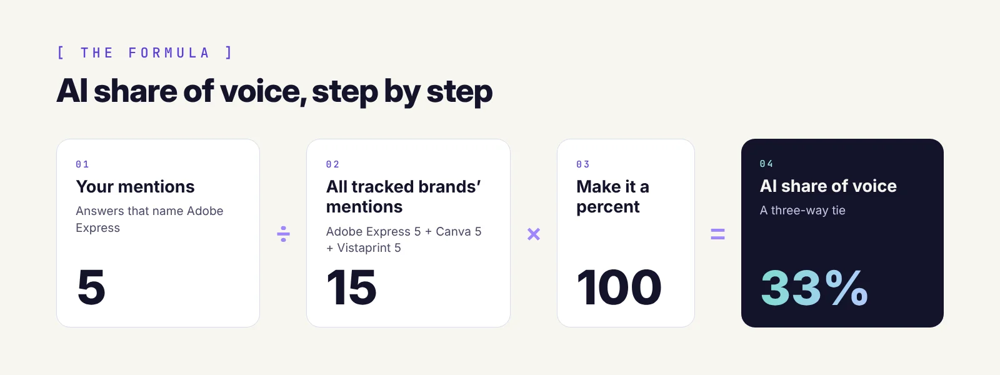

AI share of voice sounds fancy, but the math fits on a sticky note. The tricky part is knowing what to count, and what the number does and doesn't tell you.

Here's the formula, then a worked example from a real test I ran on October 27, 2026, with all the numbers left in.

## The AI share of voice formula

> **What is the AI share of voice formula?**
>
> AI share of voice = (your brand's mentions ÷ total mentions of all tracked brands) × 100. Count the mentions across the same set of AI answers, for you and every competitor you track.

Your mentions are how many times AI answers name your brand. Total mentions is the same count for every brand you track, including you. And your tracked brands are you plus the competitors you picked. Keep that list the same each month, or this month's number won't compare with last month's.

*The formula, with the numbers from my business card test.*

## What counts as a mention

Make two decisions before you count anything.

### Once per answer, or every mention?

I count each brand once per answer. If ChatGPT names Canva three times in one list, that's still one answer recommending Canva. Counting every mention can make sense for long articles or social threads, where repeat mentions add visibility. Either works, as long as you stick with it.

### Names, not links

A mention is the brand name in the answer. A web address in the source list is a citation, and I track citations separately (more on that below).

## A worked example: business card tools

Full disclosure: I've worked on Adobe Express's AI visibility as a contractor (via Envision). For this test, I asked two questions a small business owner might ask, logged out, in fresh chats: "What are the best tools for quick business card design?" and "Can you create a professional business card in minutes?" I tracked Adobe Express against [Canva](https://www.canva.com/create/business-cards/) and Vistaprint. That gave me 8 answers across three platforms.

| Platform | Answers | Adobe Express | Canva | Vistaprint |
| --- | --- | --- | --- | --- |
| Google AI Overviews | 1 | 1 | 1 | 1 |
| ChatGPT | 4 | 3 | 3 | 3 |
| Gemini | 3 | 1 | 1 | 1 |
| **All platforms** | **8** | **5** | **5** | **5** |

Now plug Adobe Express into the formula:

> 5 ÷ (5 + 5 + 5) × 100 = 33%

Canva and Vistaprint land on 33% too. It's a three-way tie on every platform, because whenever an answer named one of these tools, it named all three.

## Two numbers to track alongside it

Share of voice only compares brands with each other. It doesn't tell you how often anyone gets named at all, or whether AI sends people to your site. Two more quick formulas fill that gap.

### Mention rate

Mention rate = answers that name you ÷ total answers × 100. Adobe Express was named in 5 of 8 answers, a 63% mention rate. The other three named none of the brands I tracked: ChatGPT's answer to the yes-or-no question, and two of the three Gemini runs.

### Citation rate

Citation rate = answers that cite or link your site ÷ total answers × 100. Adobe Express was cited in 3 of 8 answers, a 38% citation rate. All three were ChatGPT answers to the "best tools" question, and each one linked [Adobe's business card page](https://www.adobe.com/express/create/business-card) directly. Citations matter because clicks are scarce: [Pew Research Center found](https://www.pewresearch.org/short-reads/2025/07/22/google-users-are-less-likely-to-click-on-links-when-an-ai-summary-appears-in-the-results/) that Google users clicked a regular search result in 8% of visits when an AI summary appeared, compared with 15% without one. (I didn't capture the source links from Gemini or the AI Overview in this round, so those may be undercounted.)

Put together, the story gets more useful. Share of voice says it's a tie. Mention rate says Adobe Express shows up in under two-thirds of answers. Citation rate says only ChatGPT is sending people to the page.

## What the formula can't tell you

### Position

Canva was listed first in every ChatGPT answer, and Adobe Express was always second. The formula counts a mention as a mention, so it can't see that. When you log your numbers, jot down where you ranked in each answer, too.

### Certainty, with small samples

Eight answers is a starting point, not a verdict. If one more Gemini run had named only Canva, Adobe Express would drop to 5 of 16 mentions, or 31%. Run each question two or three times per platform, and look at the trend over a few months before you act on a single number.

## Calculate yours

You don't have to do the math by hand (put the coffee down, it's fine). Paste your AI answers into my [free AI Share of Voice Calculator](/ai-share-of-voice-calculator), add your brand and competitors, and it works out your share of voice, mention rate and citation rate for each platform. Nothing you paste leaves your browser.

Want it done for you? An [AI visibility audit](/ai-visibility-audit) tracks all three numbers across every platform.

For help choosing the questions to test, see [how to measure AI share of voice](/blog/how-to-measure-ai-share-of-voice/).

## Summary

AI share of voice is your brand's mentions divided by the total mentions of all the brands you track, times 100. Decide how you'll count before you start, and keep the same questions and competitors each month. In my business card test, Adobe Express, Canva and Vistaprint tied at 33%, but mention rate (63%) and citation rate (38%) showed where the real gaps were. Track all three numbers, note your position in each answer, and watch the trend.
